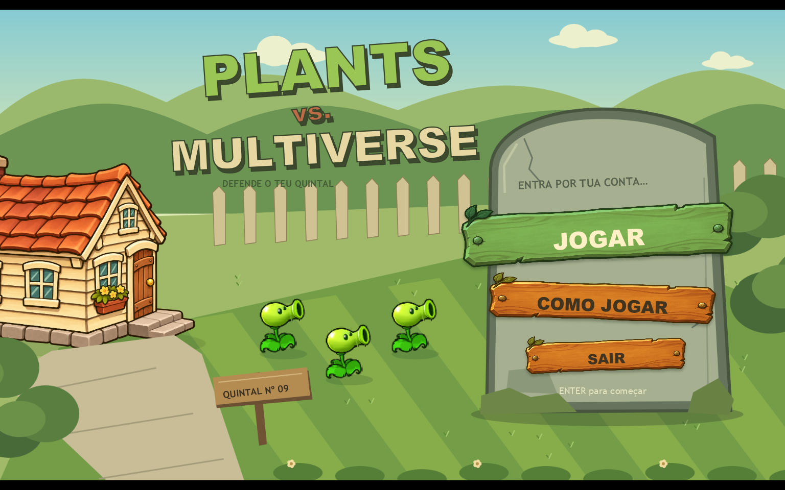
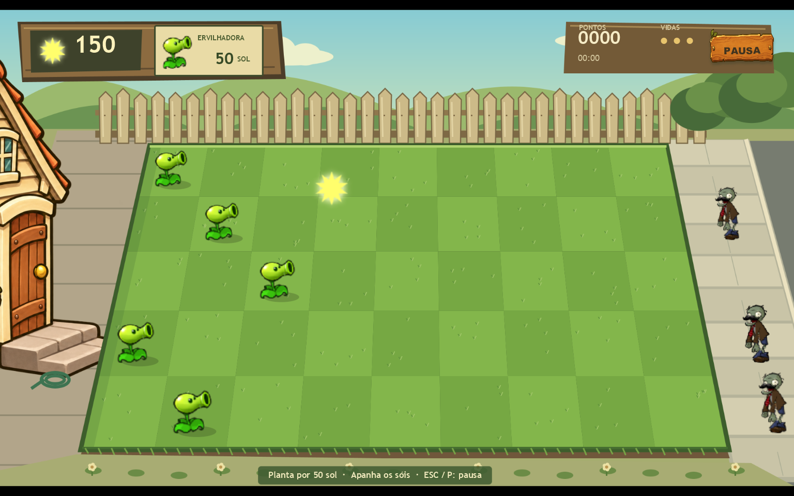
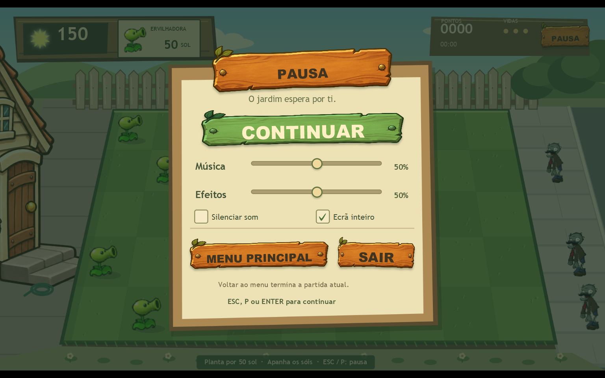
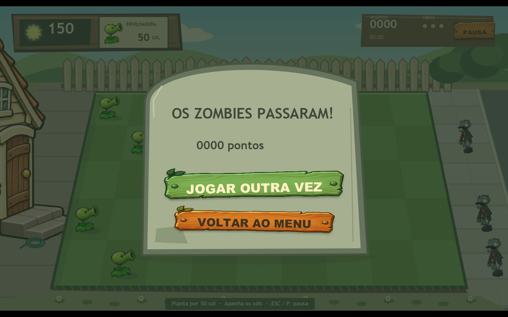

# Direção visual — quintal em perspectiva

A interface usa a composição de um jogo de jardim desenhado: casa de bairro, cerca de madeira, relva verde, título com contorno e sombra, lápide torta e placas pregadas. Os sprites existentes foram preservados. A casa e as placas dos botões usam novas imagens transparentes. O jardim, a lápide e os detalhes de cenário continuam desenhados em Canvas. Os prompts e os caminhos das artes estão em [ARTWORK.md](docs/design/ARTWORK.md).

## Menu

- **JOGAR** numa placa verde inclinada.
- **COMO JOGAR** abre e fecha um bilhete com as instruções.
- **SAIR** fecha a aplicação.
- **ENTER** começa a partida.

Os únicos movimentos decorativos são as transições curtas de entrada e a resposta das placas ao rato. Não há animação contínua dos personagens no menu.

## Mapa

O relvado tem perspectiva: as filas distantes são menores e a frente do terreno é mais larga. A calçada lateral e o acesso à casa seguem a mesma projeção. A casa, a cerca e os personagens mantêm-se verticais, em vez de serem achatados sobre a grelha.

`BoardProjection` converte as coordenadas lógicas do tabuleiro para o plano visível. A conversão inversa serve para o clique e para o contorno de seleção. As regras de combate continuam no tabuleiro lógico de 5 × 9 células. Os sprites são posicionados e dimensionados pela profundidade, sem novas rotações ou animações.

## Entrada no jardim

A ação **JOGAR**, o **ENTER** e o reinício usam a mesma transição de 750 ms. O menu afasta-se até 91% e desaparece sobre um fundo verde escuro. No ponto de corte, o jardim é preparado; depois aproxima-se de 88% até 101,8% e assenta em 100%, com um pequeno ressalto cartoon.

Durante a animação, a interface fica temporariamente bloqueada e o estado `ENTERING_GARDEN` impede cliques, disparos, novos zombies e avanço do relógio. No final, a transformação de câmara é removida e a opacidade volta exatamente a 1, preservando a projeção e os cliques do tabuleiro. Cliques repetidos não reiniciam a transição. Se o menu for aberto durante a entrada, a animação é cancelada sem iniciar uma partida depois.

Os menus padrão do FXGL estão explicitamente desativados: só a interface `GardenUI` trata da pausa e do menu principal. ESC e P abrem exclusivamente a pausa personalizada.

## Personagens e regras

Foram retirados o balanço dos zombies, o crescimento e recuo das plantas, a rotação dos sóis e os efeitos de círculos e textos que tinham sido acrescentados no primeiro redesenho. Mantêm-se os sprites, os valores de vida e velocidade, os disparos, a alimentação dos zombies e a progressão de dificuldade anteriores ao redesenho.

Cada ervilhadora custa **50 sol**; cada sol recolhido vale **25**. **ESC**, **P**, **M** ou **PAUSA** abrem ou fecham a pausa durante a partida. **ENTER** também permite continuar. O regresso ao menu faz-se pelo painel de pausa, com indicação de que termina a partida atual. **C** mantém a função de teste existente, adicionando 25 sol.

## Pausa e opções

O painel de pausa mantém o tabuleiro visível e suspende o relógio, os temporizadores de disparo e criação de entidades, os projéteis, os zombies, a queda dos sóis e o seu tempo de vida. Os cliques no tabuleiro não têm efeito até continuar. Perder o foco da janela também coloca a partida em pausa.

- **CONTINUAR**: retoma a mesma partida.
- **Música** e **Efeitos**: controlos independentes de volume, ligados às propriedades de áudio do FXGL.
- **Silenciar som**: silencia os dois canais e conserva os valores para quando o som voltar.
- **Ecrã inteiro**: alterna entre ecrã inteiro e uma janela com barra de título, preservando as proporções.
- **MENU PRINCIPAL**: termina a partida e regressa ao menu.
- **SAIR**: fecha o jogo.

Os volumes e o estado de silêncio mantêm-se entre partidas na mesma execução. Não são guardados no disco. Há pequenos sons de botões, plantio e recolha de sol. Não foram acrescentadas novas animações aos zombies.

## Ficheiros

- `GardenUI.java`: menu, placas, ajuda, barra superior, resultado, pausa e opções de áudio e janela.
- `LawnView.java`: casa, céu, cerca, vegetação, caminhos e relvado.
- `GardenTransition.java`: fade e zoom temporários da câmara ao iniciar ou repetir uma partida.
- `GardenAssets.java`: imagens partilhadas da casa e dos botões, carregadas uma vez.
- `assets/ui/garden.css`: apresentação dos controlos da pausa.
- `BoardProjection.java`: projeção do chão, seleção de células e posicionamento dos sprites.
- `GardenDefenseApp.java`: regras existentes e integração com o mapa projetado.

O trabalho partiu da branch local `Design`, no commit `bfdd464`. Não foi feito fetch, commit ou alteração de histórico. As alterações locais preexistentes no README, no Maven e na configuração do editor não foram reescritas. O projeto versiona `target/classes`, que o editor pode recompilar automaticamente.

## Verificação

Compilação com JDK 25 e dependências FXGL/JavaFX locais. Verificações em execução:

- Projeção e inversão das coordenadas das 45 células.
- Plantio em todas as células, custo correto e rejeição de cliques fora do relvado.
- Botões de jogar e abrir/fechar ajuda.
- Recolha de sol, fim de jogo, menu e reinício.
- Zombies param para comer e causam o dano original.
- Projéteis continuam a causar o dano original.
- Os zombies não recebem a rotação decorativa do primeiro redesenho.
- Pausa conserva posições, relógio, temporizadores, entidades e tempo de vida dos sóis; continuar retoma a simulação.
- Volumes de música e efeitos, silêncio e reposição dos valores anteriores.
- Regresso ao menu pelo painel de pausa e conservação do volume entre partidas.
- Alternância real entre janela decorada e ecrã inteiro, seguida de continuação da partida.
- Os PNGs carregam sem erro e têm transparência no fundo.
- Os menus padrão não são criados; ESC e P usam apenas a pausa personalizada.
- Fade e zoom nas duas fases, bloqueio de interação e relógio durante a entrada, reposição exata da câmara e opacidade.
- Entrada pelo rato e teclado, reinício e cancelamento sem callbacks tardios.

As capturas da própria cena JavaFX foram revistas para conferir o encaixe dos personagens na grelha. O Maven não estava no PATH deste ambiente; a compilação foi feita diretamente com `javac`. Num ambiente com Maven, executar `mvn compile exec:java` nesta pasta.

## Capturas atuais

